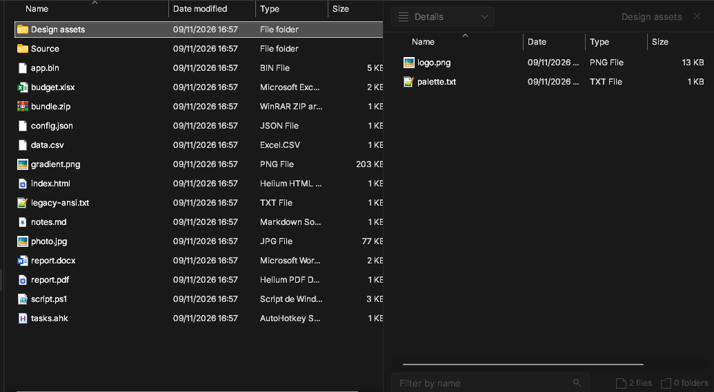
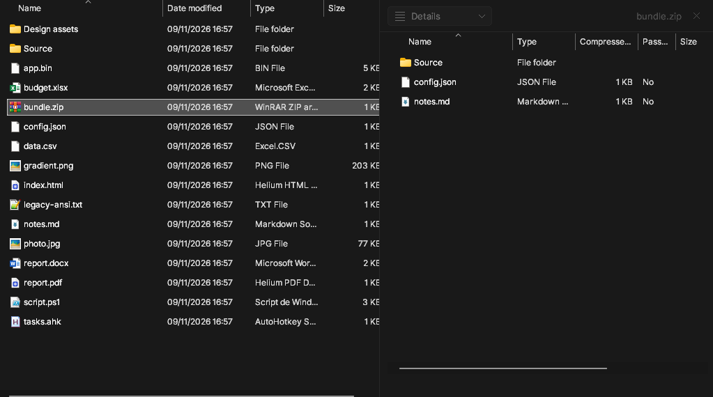
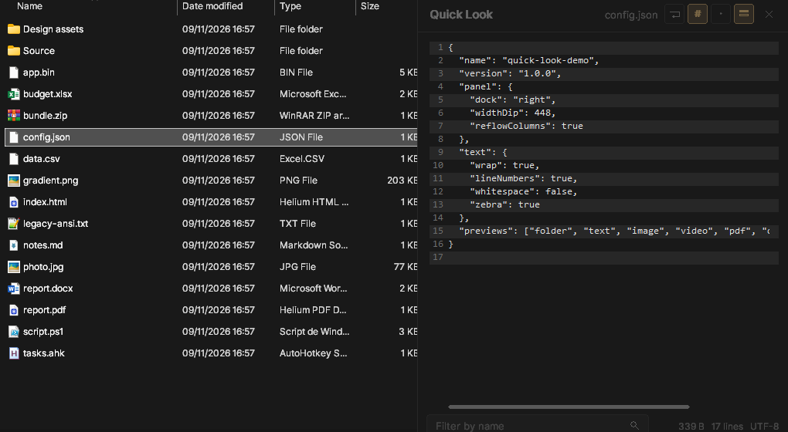
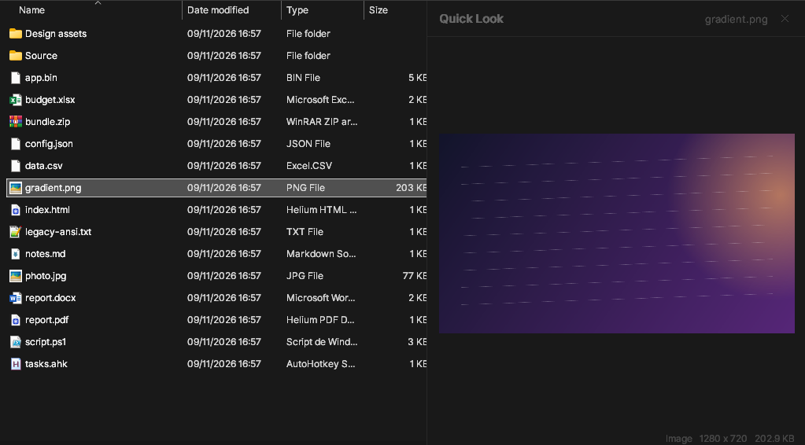
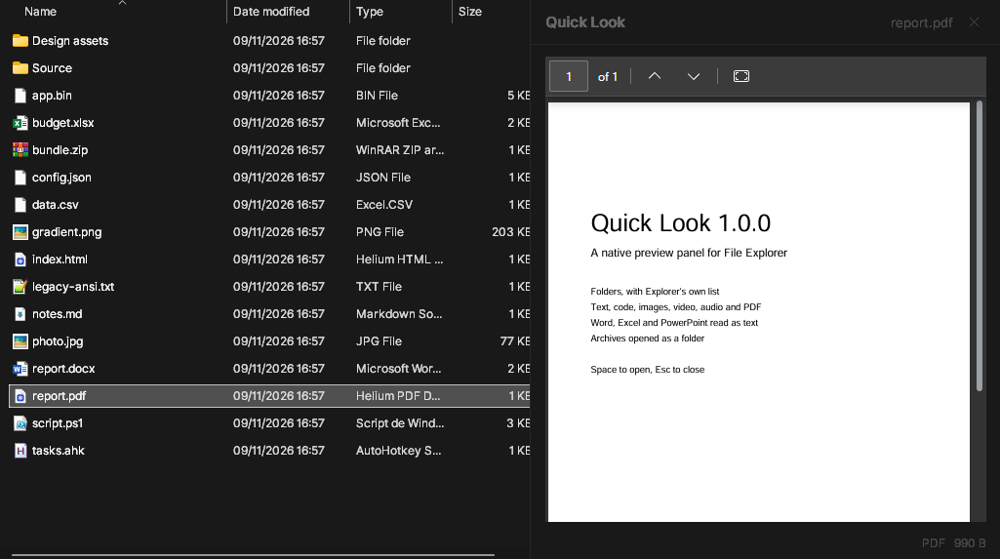
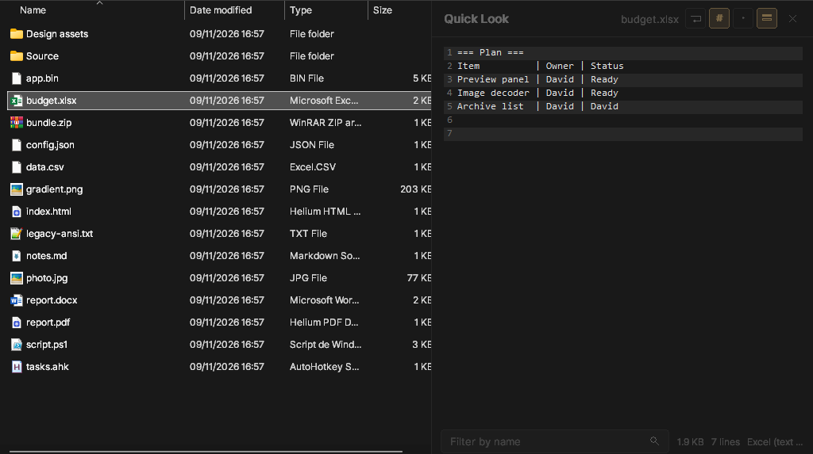

# Quick Look For Windhawk

A native Quick Look preview for Windows File Explorer, packed as a [Windhawk](https://windhawk.net) mod.

Select a file or a folder and press **Space**. That is the whole idea.

 

Quick Look docks a real panel **inside the File Explorer window**, next to the file list, and previews
whatever is selected. It is not a floating window: it is a child of the Explorer tab, so it moves with
it, is clipped to it and, if you want, shrinks the Details columns to reserve its own space, the way
File Pilot's inspector does.

Folders open with **Explorer's own file list**, not a copy: the same icons, columns, sorting, view modes
and scrollbars. Text, images, video, audio, PDF, Word, Excel, PowerPoint, archives and everything else
have their own preview or a proper fallback. Nothing runs on a timer in the background, and nothing that
touches the disk ever blocks Explorer.

## Screenshots

  

A few of the things it previews:

<table>
  <tr>
    <td align="center"> <b>Winrar/Zip</b> &middot; Support</td>
    <td align="center"> <b>Plain Text</b> &middot; Support</td>
    <td align="center"> <b>Images</b> &middot; Support</td>
  </tr>
  <tr>
    <td align="center"> <b>PDF</b> &middot; Support</td>
    <td align="center"> <b>Office Files</b> &middot; Support (Only text)</td>
    <td align="center"> <b>Folder</b> &middot; Support</td>

  </tr>
</table>

## Highlights

- **A panel, not a window.** Space opens it, Space or Esc closes it, the header has a close button for the
  mouse. It docks on the right, or at the bottom when the window is too narrow; drag its edge to change
  its width and the width is remembered.
- **Folders, with Explorer's own list.** The preview hosts a real Explorer browser, so icons, columns,
  sorting, grouping and the Details / List / Icons view modes are Explorer's. A view dropdown in the
  header switches between Details, List, Small, Medium, Large and Extra Large icons.
- **A real filter, at the same level.** Typing in the filter box shows only the matching direct children
  of the previewed folder, with their original columns, and clearing it brings the folder back. No
  subfolder is ever searched.
- **Text and code, detected by content.** No extension list: a file is text when its bytes say so, so
  `.ahk`, `.psd1`, `.config`, extensionless files and anything else just work. UTF-8, UTF-16 LE/BE and the
  ANSI code page are decoded, and the footer reports which one was used, the size and the line count.
- **An editor-style toolbar.** Word wrap, line numbers (a wrapped continuation keeps its number once), a
  whitespace inspector that draws spaces as dim dots, and alternating row colors. The four toggles are
  remembered if you want them remembered, and the defaults are settings.
- **Search inside the file.** The same filter box keeps only the matching lines, each with its original
  line number, and highlights every match with your Windows accent color.
- **Documents without Office.** Word, Excel, PowerPoint, RTF and OpenDocument files are opened as a zip
  of XML parts and reduced to their text, so they preview instantly even when Office is not installed.
  Old binary `.doc`, `.xls` and `.ppt` files use the Windows preview handler when one is registered.
- **Images, video and audio.** Images are decoded at full resolution, videos show a frame and audio shows
  its album art, both through the same still-image providers Windows uses.
- **PDF.** Rendered by the Windows PDF preview handler, the same component Explorer's preview pane uses,
  hosted inside the panel. Zoom and scroll belong to the handler.
- **Archives.** A `.zip` (and any format the shell exposes as a folder) lists its contents in the native
  list. Formats with no shell namespace fall back to the properties view.
- **A fallback that still helps.** Anything else shows the real file icon plus its type, size, modified
  date and full path.
- **Colors that follow Windows.** The panel samples Explorer's actual surface for its background and
  takes the accent from Windows itself; its text follows the theme, so it never flips between previews,
  and the sampled surface is kept only when that text stays readable on it. The theme can be left on
  Auto or forced to light or dark in the settings.
- **Explorer never freezes.** Listing a folder, reading a file, decoding an image, building a thumbnail or
  checking a cloud placeholder all run on worker threads. The panel opens at once with a loading state,
  a new selection cancels the previous load, and a file that is only a cloud placeholder is never
  downloaded just to be previewed.

## Install

1. Install [Windhawk](https://windhawk.net) (Windows 10 or 11).
2. In Windhawk open **Mods** → **Create a new mod**, paste the contents of
   [`quick-look.wh.cpp`](quick-look.wh.cpp) in place of the editor contents and save.
3. Select a file or folder in File Explorer and press **Space**.

Quick Look is an **injected** mod: it runs inside `explorer.exe`, which is what lets the panel be a real
child of the window instead of a window that follows it.

## Keys

| Key | Action |
| --- | --- |
| **Space** | Open or close the preview |
| **Esc** | Close the preview |
| **Click the close button** | Close the preview with the mouse |
| **Shift + wheel** | Scroll a text preview sideways when word wrap is off |
| **Mouse wheel / drag the bars** | Scroll the preview |

## Settings

| Setting | Default | What it does |
| --- | --- | --- |
| Theme | Auto | Follows the Windows light or dark app mode, with the sampled Explorer surface as a tie-breaker. Force light or dark for a custom visual style that does not match the Windows theme. The embedded folder and archive list follows it too. |
| Shrink columns to fit the panel | On | Shrinks the file view and scales the Details columns to the space left by the panel. Turn it off to overlay the panel instead. |
| Remember the text preview options | On | Keeps wrap, line numbers, whitespace dots and alternating rows as you left them for the next window or session. |
| Line numbers by default | Off | The gutter used when the options are not remembered. |
| Alternating rows by default | Off | The alternating row color used when the options are not remembered. |

## What each file shows

| Selection | Preview |
| --- | --- |
| Folder | Explorer's native list, with a view dropdown, a name filter and file/folder counts |
| Text, code, config, logs | Text with wrap, line numbers, whitespace dots, alternating rows and in-file search |
| Word, Excel, PowerPoint, RTF, OpenDocument | The document text, read directly without Office |
| Old `.doc`, `.xls`, `.ppt` | The Windows preview handler when one is installed, otherwise the properties view |
| Images (`png`, `jpg`, `gif`, `bmp`, `tif`, `ico`, `webp`…) | The decoded image, fitted to the panel |
| Video and audio | A frame or the album art, as Windows produces it |
| PDF | The Windows PDF preview handler, hosted in the panel |
| Archives (`.zip`, and formats with a shell namespace) | The archive contents in the native list |
| Anything else | The real file icon with type, size, modified date and path |

## How it behaves

- **The panel never navigates.** Double-clicking a folder inside the preview opens its **Properties**;
  it does not enter it. Quick Look is a preview, not a file manager.
- **Single click selects.** A double click on empty space does nothing.
- **Cloud files are left alone.** A file that is only a placeholder is not downloaded to be previewed.
- **Text is capped.** A text preview reads the first 200 KB and says so in the footer.

## Limitations

- **A forced theme can mismatch the Windows mode.** The folder and archive list is drawn by Explorer
  itself. When the panel's Theme is forced to a mode that differs from Windows' own app mode, the
  list's rows follow the panel but its scrollbar and parts of its header can keep the Windows look.
  For the most native result, set the same mode as Windows, or leave Theme on Auto.

## Troubleshooting

- **Space does nothing.** The panel only opens when the file list itself has the focus, so a pending
  rename, an address bar edit or the search box is never hijacked. Click the file list and try again.
- **Something looks wrong.** Turn on the Windhawk log for this mod (Advanced tab), reproduce it and
  attach the log to the issue. It is off by default because it adds a line for every step.
- **A document shows only text.** That is by design: modern Office and OpenDocument files are read as
  text, so layout, images and colors are not part of the preview.

## Contributing

Bug reports, fixes and new features are welcome. Open an
[issue](https://github.com/DavidRaveloU/Quick-Look-Windhawk/issues) with your Windows build, the mod
version, the steps to reproduce it and, when it is visual, a screenshot or a short clip.

For a pull request: fork, branch from `main`, change `quick-look.wh.cpp`, confirm it compiles and open
the PR describing **what** changed and **why**. One bug or feature per PR is much easier to review.

Leave `@version` in the mod header and `version.json` alone: the maintainer sets both when a release is
published, so they always agree with what the mod shows.

## License

Released under the **MIT License**. See [`LICENSE`](LICENSE).
The inflate code that reads Word and OpenDocument files is derived from zlib's `puff.c` and keeps its
zlib license notice in the source.

Copyright (c) 2026-present David Ravelo.
